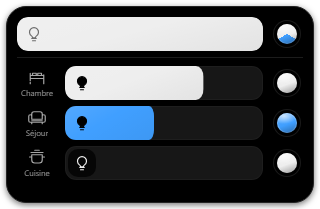

# Home Control

A small, deep-black Windows tray app for Matter lights. Built with Rust, Tauri and a bundled Matter.js controller.

[Download for Windows](https://github.com/Lorkydey/HomeControl/releases/latest) | [Français](docs/README.fr.md) | [Configuration example](config.example.json)



- A global brightness bar and individual bulb toggles. Drag right to brighten.
- White temperature, RGB/HEX, hue, saturation and presets, when supported by the bulb.
- Local Matter control, persistent connections and independent command queues.
- A compact bottom-right popover with polished color controls and interruptible motion. Reduced motion is respected.
- Configure **1 to 8 lights**, names/icons, panel width and outside-click behavior in JSON.

The interface is currently in French. Windows x64 is the supported distribution target; macOS, Linux and Windows ARM installers are not provided.

## Install and pair

1. Download `Home.Control_0.2.0_x64-setup.exe` and `SHA256SUMS.txt` from [Releases](https://github.com/Lorkydey/HomeControl/releases).
2. Install, then open Home Control from the notification area. Windows may hide its icon among the overflow icons. The installer is currently **unsigned**. Node.js is included. WebView2 is downloaded if missing, requiring Internet access ([Tauri documentation](https://v2.tauri.app/distribute/windows-installer/#webview2-installation-options)).
3. In the app already controlling the bulb, enable **Matter sharing / pairing mode** and generate a fresh temporary code. In Apple Home, use **Turn On Pairing Mode** in the accessory settings.
4. Click an unpaired bulb icon in Home Control and enter the code. Repeat for other lights.

The PC and bulbs must be reachable on the same local network with IPv6 and multicast discovery. Home Control does not change Windows network settings. Thread lights require a reachable Thread border router.

This adds a Matter controller without removing your existing ecosystem. It does **not** provision Wi-Fi over Bluetooth: initially set up a new bulb with its manufacturer's app or another Matter ecosystem first. A printed setup code alone does not reopen pairing on an already commissioned device. Manufacturer-specific animated and music scenes are not provided.

## Configuration

On first launch, the app creates:

```text
%LOCALAPPDATA%\fr.lorkydey.homecontrol\config.json
```

Right-click the tray icon and choose **Ouvrir la configuration** to open it. Quit Home Control before editing, save the file, then relaunch. [config.example.json](config.example.json) is a complete starter file; [config.schema.json](config.schema.json) describes the format. A schema copy is created beside the user's config.

```json
{
  "version": 1,
  "window": { "width": 320, "margin": 8, "hideOnBlur": true },
  "lights": [
    { "id": "desk", "name": "Office", "icon": "desk" },
    { "id": "reading", "name": "Reading", "icon": "bulb" }
  ]
}
```

| Setting             | Values                                                                                                |
| ------------------- | ----------------------------------------------------------------------------------------------------- |
| `window.width`      | 280-480 logical pixels; default 320                                                                   |
| `window.margin`     | 0-32 logical pixels from the work area; default 8                                                     |
| `window.hideOnBlur` | `true` to hide when focus leaves the app                                                              |
| `lights`            | 1-8 entries, in display order                                                                         |
| `lights[].id`       | Unique stable ID: lowercase initial letter, then lowercase letters/digits/hyphens, max. 32 characters |
| `lights[].name`     | 1-40 characters                                                                                       |
| `lights[].icon`     | `bulb`, `bed`, `sofa`, `kitchen`, `desk`, `sun`                                                       |

**Keep an existing light's `id` unchanged after pairing.** Reordering entries or changing names/icons is supported. Removing an entry hides it but preserves its private pairing; restoring the same `id` brings it back. Renaming through the tray menu also updates this configuration. Existing pre-config installations migrate automatically without pairing again.

The global bar remembers its own last brightness setting. Changing one light does not lower this setting or change another light. If only some lights are on, the global power button turns the remaining lights on; if all are on, it turns them all off.

## Privacy and troubleshooting

`config.json` contains display preferences, not pairing credentials. **`lights.json` and the `matter/` directory are private controller data** in the same app-data folder. Never upload that folder, attach it to an issue or put it in the repository. Deleting it loses this controller's identity and requires sharing the lights again.

Home Control needs no cloud account. It communicates with bulbs over local Matter; app commands use private Rust/Node pipes without an HTTP control server. Initial encrypted sessions can take a few seconds; keeping the app in the tray preserves them. Install updates manually from Releases.

If pairing fails, generate a new sharing code, check IPv6 on the active adapter and ensure local multicast is available. Invalid configuration reports its file path and error at startup; fix it and restart. For other issues include the app version and bulb model, **without codes, network captures or controller files**. See [SECURITY.md](SECURITY.md) for private security reports.

## Develop and validate

Windows prerequisites: Node.js 24 (at least 24.15), Rust stable with MSVC build tools, and WebView2. There is no npm package publication; npm is used for dependencies and development scripts.

```powershell
npm ci
npm run app:dev
```

```powershell
npm run check
npm run format:check
npm test
npx playwright install chromium
npm run test:ui
cargo fmt --manifest-path src-tauri/Cargo.toml --check
cargo test --locked --manifest-path src-tauri/Cargo.toml
npm run app:build
```

The installer is produced in `src-tauri/target/release/bundle/nsis/`. Tests cover a separate simulated Matter bulb, commands, reconnection, pairing persistence, configuration migration, slot reordering and UI behavior. Physical development testing used Linkind 1600 lm bulbs; compatibility with every Matter light is not guaranteed.

Pull requests use the enforced **CI result** gate. Code, dependency and workflow changes run full Windows validation and the installed-app smoke test. Documentation-only changes use lightweight source/whitespace checks. See [CONTRIBUTING.md](CONTRIBUTING.md).

MIT licensed. Dependencies retain their licenses; see [THIRD_PARTY_NOTICES.md](THIRD_PARTY_NOTICES.md).
